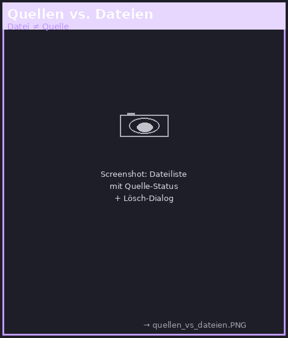
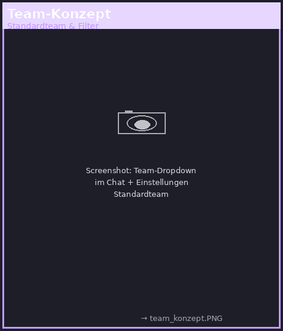

## Benutzer & Teams

### 3. Benutzer

Sichtbar für: Admin + Key User (Key User sieht nur eingeschränkte Ansicht)

Dieser Tab hat drei Untertabs:

**3.1 Benutzerliste**

<table>
  <tr>
    <td valign="top" width="42%">
      
    </td>
    <td valign="top">

- Tabelle mit Spalten: username, role, team, standardteam, can_read, can_upload, storage_mb, id
  - Sortierbar nach jeder Spalte (Dropdown "Sortieren nach" + aufsteigend/absteigend)
- Beim Klick auf einen Benutzer öffnet sich der Bearbeitungsbereich:
  - Benutzername — editierbar (3-32 Zeichen, nur Buchstaben/Zahlen/Unterstriche)
  - Passwort ändern + Passwort bestätigen (nur ausfüllen wenn geändert werden soll)
  - Rolle — Dropdown, je nach Berechtigung des eingeloggten Users:
    - Admin: sieht alle 3 Rollen -> admin, key_user, user
    - Key User: sieht nur user
    - User: sieht nur sich selbst und kann das Standardteam ändern
  - Teams — Mehrfachauswahl (Dropdown)
    - Admin sieht ALLE Teams
    - Key User sieht nur die Teams, die er selbst erstellt hat
  - Standardteam — Dropdown (einfach)
    - Admin: alle Teams wählbar
    - Key User: eigene Teams + globale Teams
  - Leserechte (Checkbox)
  - Upload-Rechte (Checkbox)
  - Buttons: Speichern | Löschen (mit Bestätigungsdialog) | Schließen

    </td>
  </tr>
</table>

Rollen-Detail:

| Rolle | Berechtigungen |
|---|---|
| admin | Vollzugriff auf alle Ressourcen-Tabs, kann alle Rollen vergeben, sieht alle Benutzer |
| key_user | Erstellt und verwaltet eigene Teams und Benutzer (nur user), sieht nur eigene Teams |
| user | Basis-Rolle, sieht keine Ressourcen-Tabs, Lese-/Upload-Rechte konfigurierbar |

Einschränkungen beim Bearbeiten:
- Ein User kann sich nicht selbst löschen
- Ein User (nicht Admin) darf für sich selbst nur das Standardteam ändern
- Ein Key User darf nur User in seinen eigenen Teams bearbeiten/löschen
- Admin darf keine Team-Zuordnung haben
- Key User und User müssen mindestens einem Team zugeordnet sein

**3.2 Benutzer anlegen**

- Benutzername (Textfeld)
- Passwort + Passwort bestätigen (beide versteckt)
- Rolle — Dropdown (angepasst an Berechtigung des Erstellers)
  - Admin: user, key_user, admin
  - Key User: nur user
- Teams — Mehrfachauswahl
- Standardteam — Dropdown
- Leserechte (Checkbox, default: true)
- Upload-Rechte (Checkbox, default: false)
- Regeln-Übersicht:
  - Benutzername: 3-32 Zeichen, keine Groß-/Kleinschreibung, nur Buchstaben/Zahlen/Unterstriche
  - Passwort: mind. 8 Zeichen, 1 Großbuchstabe, 1 Kleinbuchstabe, 1 Ziffer, 1 Sonderzeichen
- "Benutzer anlegen" Button

**3.3 Teams**

<table>
  <tr>
    <td valign="top" width="42%">
      
    </td>
    <td valign="top">

Es gibt zwei Ebenen, auf denen Teams zugeordnet werden können:

**(A) Dateiebene**
- Jede hochgeladene Datei kann einem oder mehreren Teams zugeordnet werden

**(B) Gruppenebene**
- Jede Dateigruppe kann einem oder mehreren Teams zugeordnet werden

Wichtig: Die beiden Ebenen sind unabhängig voneinander.

Sichtbarkeit – Wer sieht was?

| Regel | Sichtbar für |
|-------|-------------|
| **Admins** | Alle Dateien und Gruppen |
| **Globale Teams** | Alle Nutzer (systemweit sichtbar) |
| **Ohne Team-Zuordnung** | Nur der Ersteller |
| **Mit Team-Zuordnung** | Nur Mitglieder dieser Teams |

Team-Filter auf der Chat-Seite:
- "Alle Teams" -> Admin sieht alles, Nutzer nur eigene Teams
- Konkretes Team -> Nur Dateien/Gruppen des gewählten Teams

    </td>
  </tr>
</table>

---

### 4. Dokumentenverwaltung

<table>
  <tr>
    <td valign="top" width="42%">
      
    </td>
    <td valign="top">

**4.1 Dateien hochladen**
- einzelne oder mehrere Dateien gleichzeitig hochladen
- unterstützte Formate: PDF, DOCX, PPTX, Excel, CSV, Bilder, Markdown, Text, HTML, ZIP

**4.2 Indexierung**
- Dokumente werden automatisch analysiert
- Status wird in der Datei-Liste angezeigt (z. B. "fertig" oder "in Bearbeitung")

**4.3 Quellen vs. Dateien**

Wichtiger Unterschied:
- **Datei** = die Originaldatei die du hochgeladen hast (z.B. Handbuch.pdf)
- **Quelle** = der indexierte Inhalt, der im Chat durchsucht wird

Was bedeutet das praktisch?
- Löschst du die Datei, bleibt die Quelle erhalten → Inhalte sind weiterhin suchbar
- Löschst du die Quelle, ist der Inhalt endgültig weg
- Zum vollständigen Entfernen: erst Quelle löschen, dann Datei löschen

<table>
  <tr>
    <td valign="top" width="42%">
      
    </td>
    <td valign="top">
⚠️ **Platzhalter** — bitte durch echten Screenshot ersetzen.
    </td>
  </tr>
</table>

**4.4 Team-Zuordnung beim Upload**
- Dateien können direkt einem oder mehreren Teams zugewiesen werden
- ohne Zuordnung bleibt die Datei nur für den Ersteller sichtbar

    </td>
  </tr>
</table>

---

### 5. Dateigruppen

- Dokumente können in Gruppen organisiert werden
- Gruppen erleichtern die strukturierte Suche im Chat
- Jede Gruppe kann eigenen Teams zugeordnet werden (unabhängig von den enthaltenen Dateien)

---

### 6. Team-Konzept

<table>
  <tr>
    <td valign="top" width="42%">
      
    </td>
    <td valign="top">

**Was ist ein Team?**
Ein Team ist eine Gruppe von Benutzern, die gemeinsame Dokumente sehen und bearbeiten. Teams steuern, wer welche Dateien und Dateigruppen sehen kann.

**Was bedeutet "globales Team"?**
Ein globales Team ist für ALLE Benutzer sichtbar — unabhängig von ihrer Team-Zugehörigkeit. Nur Admins können Teams als global markieren. Ideal für unternehmensweite Dokumente wie Organigramme oder allgemeine Richtlinien.

**Standardteam vs. Team-Filter**
- **Standardteam** (in den Einstellungen): Wird automatisch vorausgewählt wenn du einen neuen Benutzer anlegst oder eine Datei hochlädst. Ist dein "Heimat-Team".
- **Team-Filter** (im Chat): Schränkt die Suche temporär auf ein bestimmtes Team ein. Ändert nichts an deinen Einstellungen.

**Sichtbarkeits-Matrix**

    </td>
  </tr>
</table>

|  | Admin | Key-User (eigenes Team) | Key-User (fremdes Team) | User (Mitglied) | User (nicht Mitglied) |
|--|-------|------------------------|------------------------|----------------|----------------------|
| Dateien ohne Team | ✅ | ❌ | ❌ | ❌ | ❌ |
| Dateien im Team | ✅ | ✅ | ❌ | ✅ | ❌ |
| Dateien in globalem Team | ✅ | ✅ | ✅ | ✅ | ✅ |
| Teams in Liste sehen | Alle | Nur eigene | Keine | Nur eigene | Keine |

---

### 7. Speicherverbrauch

In der Benutzerliste (nur Admin sichtbar) zeigt die Spalte **MB** wie viel Speicherplatz jeder Benutzer durch seine hochgeladenen Dateien belegt.

- Die Anzeige ist ein Richtwert
- Gelöschte Quellen werden nicht mehr mitgezählt
- Bei vollem Speicher: Alte Quellen löschen oder Admin kontaktieren

---
