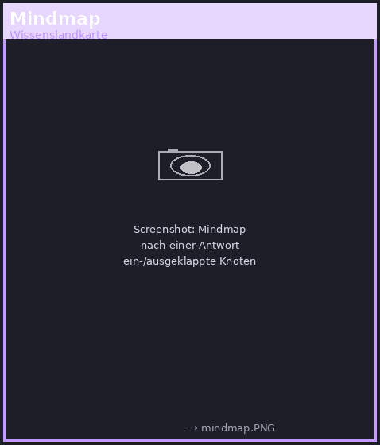

## Zentrale Funktionen

### 1. Chat mit Dokumentbezug

- Nutzer können normale Chats mit KI führen
- Antworten können auf eigenen Dokumenten basieren
- Mehrere Reasoning-Ansätze stehen zur Verfügung, z. B. einfache QA oder Agentenlogik

#### 1.1 Dateisammlung

<table>
  <tr>
    <td valign="top" width="42%">
      
    </td>
    <td valign="top">

- **"Alle durchsuchen"**
  - durchsucht automatisch **alle verfügbaren Dokumente** im aktuellen Suchbereich
  - keine manuelle Auswahl von Dateien oder Gruppen nötig

- **"In Dateien suchen"**
  - durchsucht **nur die explizit ausgewählten einzelnen Dokumente**
  - geeignet für gezielte Abfragen in bestimmten Dateien

- **"In Dateigruppen suchen"**
  - durchsucht **alle Dokumente innerhalb der ausgewählten Gruppen**
  - sinnvoll für strukturierte, thematische Suchen

- **Teamfilter ("Teams")**
  - "Alle Teams" -> Suche über **alle für dich sichtbaren Inhalte**
  - einzelnes Team -> Suche **nur innerhalb dieses Teams**

    </td>
  </tr>
</table>

**Wann nutze ich welchen Modus?**

| Modus | Geeignet für |
|-------|-------------|
| Alle durchsuchen | Schnelle Suche, ich weiß nicht wo die Info steht |
| In Dateien suchen | Ich kenne die genaue Datei (z.B. Handbuch.pdf) |
| In Dateigruppen suchen | Thematische Suche (z.B. alle Q3-Berichte) |

Typischer Ablauf:
1. Chat starten
2. Dokumente oder Gruppen auswählen
3. Frage stellen
4. System sucht relevante Inhalte
5. KI generiert eine Antwort auf Basis dieser Inhalte

---

### 1.2 Mindmap

<table>
  <tr>
    <td valign="top" width="42%">
      
    </td>
    <td valign="top">

Nach jeder Antwort erscheint ein **Mindmap**-Button. Ein Klick darauf erstellt eine visuelle Wissenslandkarte aus der Antwort:

- Zeigt die wichtigsten Konzepte und Zusammenhänge als Baumdiagramm
- Hilft komplexe Themen schnell zu überblicken
- Ideal für Präsentationen oder zum Teilen mit Kollegen
- Jeder Knoten kann ein- und ausgeklappt werden

    </td>
  </tr>
</table>

---

### 1.3 Tipps für gute Fragen

Schlecht: "Was steht in dem Dokument?"
Gut: "Fasse die Sicherheitsvorschriften aus Kapitel 3 zusammen."

Schlecht: "Erklär mir das."
Gut: "Was sind die drei wichtigsten Änderungen in Version 2.0 gegenüber Version 1.0?"

**Goldene Regeln:**
- Sei so konkret wie möglich
- Nenne das Dokument/die Dateigruppe beim Namen
- Stelle EINE Frage auf einmal
- "Fasse zusammen", "Vergleiche", "Liste auf" sind gute Einstiege
- Je präziser die Frage, desto besser die Antwort

---

### 2. Textsprache

<table>
  <tr>
    <td valign="top" width="42%">
      
    </td>
    <td valign="top">

- **Sprache**
  - Über das Dropdown **Sprache** kann die Ausgabesprache verändert werden
  - Geschrieben werden kann in jeder Sprache
  - Nach der Eingabe wird die Antwort in der ausgewählten Sprache ausgegeben

    </td>
  </tr>
</table>

---
