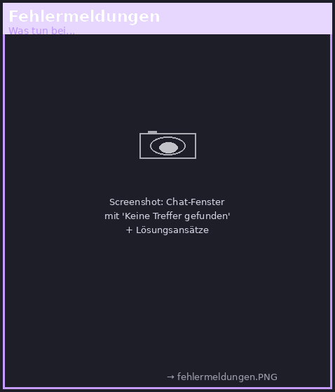

## Häufige Fehlermeldungen

<table>
  <tr>
    <td valign="top" width="42%">
      
    </td>
    <td valign="top">
⚠️ **Platzhalter** — bitte durch echten Screenshot ersetzen.
    </td>
  </tr>
</table>

| Meldung | Bedeutung | Lösung |
|---------|-----------|--------|
| **Keine Treffer gefunden** | Keine relevanten Textstellen in den Dateien | Andere Suchbegriffe probieren, Suchmodus prüfen, warten bis Datei indiziert ist |
| **Datei zu groß (max. X MB)** | Die Datei überschreitet das Upload-Limit | Datei verkleinern oder Admin bitten Limit zu erhöhen |
| **Maximale Anzahl an Dateien erreicht** | Das Datei-Kontingent ist voll | Nicht benötigte Dateien/Quellen löschen |
| **Ungültige URL** | Die eingegebene URL ist falsch formatiert | URL muss mit http:// oder https:// beginnen |
| **Denke nach …** (bleibt lange) | Die KI verarbeitet deine Anfrage | Normal bei großen Dokumenten. Wenn >30 Sekunden: F5 drücken |
| **Keine Antwort gefunden** | Die KI konnte keine sinnvolle Antwort generieren | Frage präziser formulieren |
| **Du darfst diesen Benutzer nicht anlegen** | Fehlende Berechtigung oder Team-Konflikt | Prüfen ob du Key-User bist und mind. ein Team hast |

---

## Häufige Fragen (FAQ)

**F: Warum sehe ich bestimmte Dateien nicht?**
A: Prüfe: 1) Bist du im richtigen Team? 2) Ist die Datei einem Team zugeordnet? 3) Bist du Mitglied dieses Teams? Dateien ohne Team-Zuordnung sind nur für den Ersteller sichtbar.

**F: Warum dauert die erste Suche so lange?**
A: Beim ersten Zugriff wird das KI-Modell geladen. Die zweite Suche ist deutlich schneller.

**F: Kann ich eine Datei löschen ohne die Suchtreffer zu verlieren?**
A: Ja! Datei und Quelle sind getrennt. Lösche nur die Datei — die Quelle bleibt erhalten. Lösche die Quelle nur, wenn du den Inhalt endgültig entfernen willst.

**F: Ich habe mein Passwort vergessen — was nun?**
A: Dein Admin kann ein neues Passwort für dich setzen (Benutzereinstellungen).

**F: Wie lade ich mehrere Dateien auf einmal hoch?**
A: Im Datei-Upload-Dialog mehrere Dateien auswählen (Strg+Klick oder Shift+Klick) und gemeinsam hochladen.

**F: Änderungen werden nicht angezeigt — was tun?**
A: Browser-Cache leeren mit Strg+F5. Nach Docker-Updates kann der alte Cache stören.

---

## Bekannte Probleme & Workarounds

| Problem | Lösung |
|---------|--------|
| Nach einem Update funktioniert etwas nicht | Strg+F5 drücken (Browser-Cache leeren) |
| Bilder im Hilfe-Reiter laden nicht | Strg+F5 drücken |
| Klick auf Bild vergrößert es nicht | Seite neu laden (F5), dann Strg+F5 |
| Chat bleibt bei "Denke nach …" hängen | Seite neu laden (F5) und Frage erneut stellen |

---

## Technische Highlights

- vollständig lokal betreibbar
- Docker-fähig
- deutsche Oberfläche
- modular erweiterbar
- unterstützt viele KI-Anbieter
- robuste Dokumentverarbeitung, auch für Office-Dateien

---

## Kurz gesagt

Kaidoku ist eine lokale Wissensplattform mit KI-Unterstützung:

- Dokumente hochladen oder automatisch synchronisieren
- Inhalte durchsuchen
- Fragen stellen
- fundierte Antworten aus eigenen Daten erhalten

Ziel: internes Wissen effizient nutzbar machen.