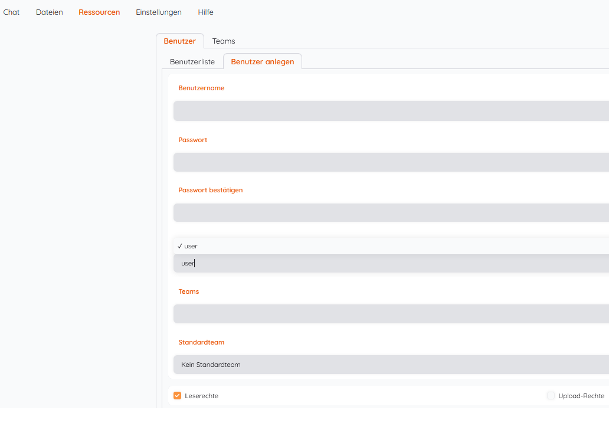

# Anleitung: Rolle Key User

<table>
  <tr>
    <td valign="top" width="42%">
      
    </td>
    <td valign="top">

## Überblick
Als `key_user` verwaltest du dein Team eigenständig. Du bist die Schnittstelle zwischen Admin und normalen Nutzern.

## Was du typischerweise tust

### Teams verwalten
- Erstelle eigene Teams für deine Abteilung / dein Projekt
- Benenne deine Teams um
- Lösche Teams, die du nicht mehr brauchst (Benutzer-Zuordnungen werden automatisch bereinigt)

### Benutzer im Team verwalten
- Lege neue `user` an und weise sie deinen Teams zu
- Bearbeite bestehende Nutzer (Rolle, Teams, Rechte)
- Entferne Nutzer aus deinen Teams oder lösche sie

### Dokumente verwalten
- Lade Dokumente in deine Teams hoch
- Weise Dateien und Dateigruppen deinen Teams zu
- Organisiere Inhalte für dein Team

### Anwendung nutzen
- Arbeite mit Chat, Dateien und Ressourcen
- Passe deine eigenen Einstellungen an (Passwort, Standardteam)

## Was du bei Teams beachten musst

- Du erstellst ein Team → du bist automatisch Eigentümer und Mitglied
- Du siehst in der Team-Liste NUR deine eigenen Teams
- Andere Key-User sehen deine Teams nicht (auch wenn sie Mitglied sind)
- Der Admin sieht alle Teams und kann den Global-Status setzen
- Beim Löschen eines Teams werden alle Benutzer-Zuordnungen automatisch entfernt

## Was du NICHT tun kannst

- Keine Admins oder andere Key User erstellen (nur `user`-Rolle)
- Keine Teams als global markieren (nur Admin)
- Keine Systemkonfiguration ändern (LLMs, Embeddings, Indizes)
- Kein FileSync einrichten

## Wichtige Hinweise

- Du brauchst mindestens ein eigenes Team um Benutzer anzulegen
- Du verwaltest nur deine eigenen Teams
- Du hast immer Lese- und Uploadrechte
- Benutzer die du erstellst, siehst du immer in deiner Liste — auch ohne Team-Zuordnung
- Dein erstelltes Team erscheint sofort in allen Dropdowns (Datei-Upload, Benutzer-Anlage, Dateigruppen)

## Best Practice

- Erstelle ein Team pro Abteilung/Projekt
- Halte deine Teams übersichtlich — lieber mehrere kleine als ein großes
- Gib Upload-Rechte nur gezielt weiter
- Lösche ungenutzte Teams regelmäßig
- Unterstütze deine User bei der Nutzung der Plattform

    </td>
  </tr>
</table>