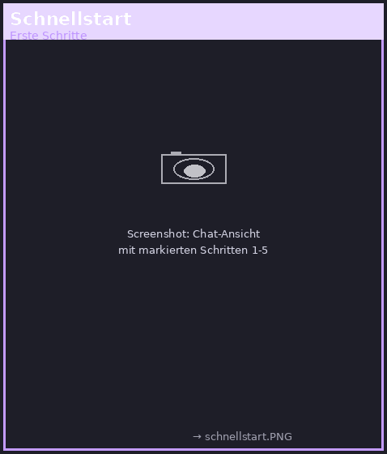

# Anleitung: Allgemeiner Überblick

## Was ist Kaidoku?

Kaidoku ist eine lokal betreibbare RAG-Anwendung (Retrieval-Augmented Generation).
Sie kombiniert:

- Chat mit KI-Modellen
- Dokumentensuche und -analyse
- Wissensaufbereitung aus eigenen Dateien
- Verwaltung von Inhalten und Datenquellen

Die Anwendung läuft lokal und kann ohne Cloud-Abhängigkeit betrieben werden.

---

## Schnellstart – Erste Schritte

1. **Anmelden** — mit deinem Benutzernamen und Passwort
2. **Team wählen** — oben rechts im Chat dein Standardteam einstellen
3. **Datei hochladen** — im Tab "Dateien" deine erste PDF/Datei hochladen
4. **Frage stellen** — im Tab "Chat" eine Frage zur Datei eingeben
5. **Antwort lesen** — die KI antwortet mit Quellenangaben und Seitenzahlen

Tipp: Nach dem Upload kurz warten bis die Datei als "fertig" markiert ist — dann ist sie durchsuchbar.

<table>
  <tr>
    <td valign="top" width="42%">
      
    </td>
    <td valign="top">
⚠️ **Platzhalter** — bitte durch echten Screenshot ersetzen.
    </td>
  </tr>
</table>

---
